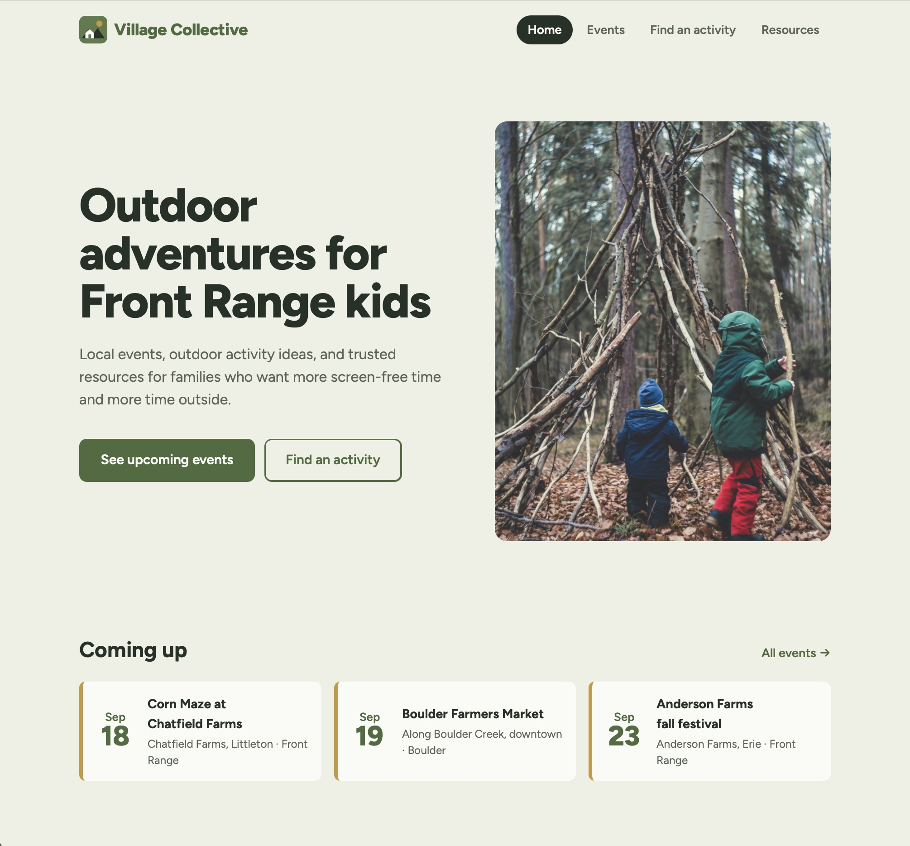
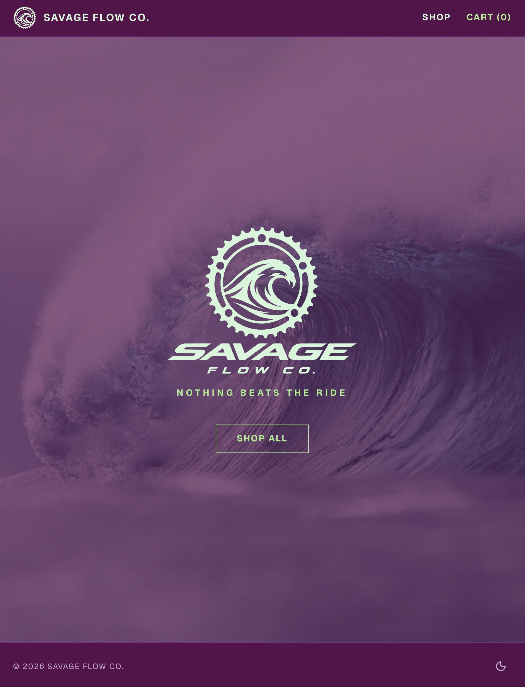

  
  

<h2 align="center">About Me</h2>

I'm a Software Engineer who loves turning complex problems into simple, effective solutions. I enjoy building full-stack web applications, exploring new technologies, and continuously improving my craft.

When I'm not behind a keyboard, you'll likely find me out on my bike, exploring the outdoors, or spending quality time with my family.

Check out <a href="https://laurasims.dev">my portfolio</a> to learn more about me.

<h2 align="center">Featured Projects</h2>

<table align="center">
  <tr>
    <td width="50%" valign="top">
      <h3 align="center">Village Collective</h3>
      
      

        
      

      

        Explore Village Collective
      

    </td>
    <td width="50%" valign="top">
      <h3 align="center">Savage Flow Co.</h3>
      
      

        
      

      

        Explore Savage Flow Co.
      

    </td>
  </tr>
</table>

<h2 align="center">Technologies</h2>

  
  
  
  
  
  
  
  
  

